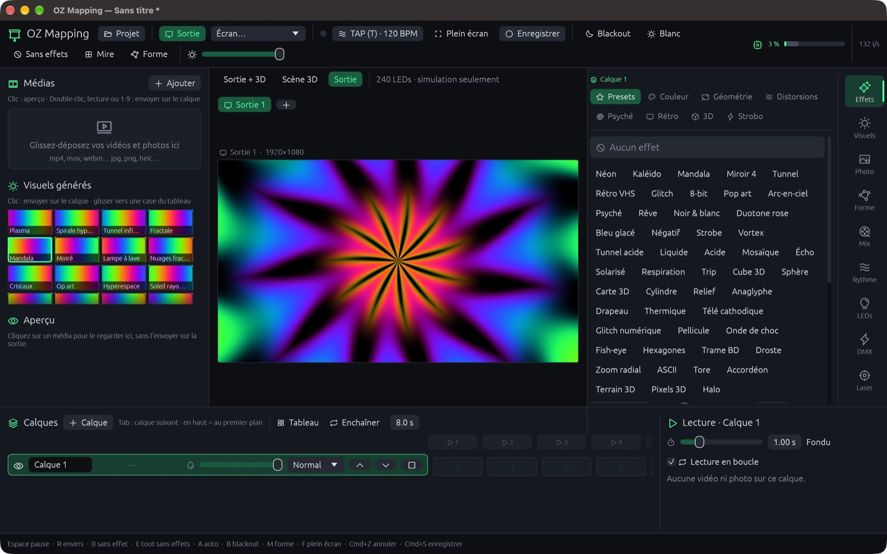
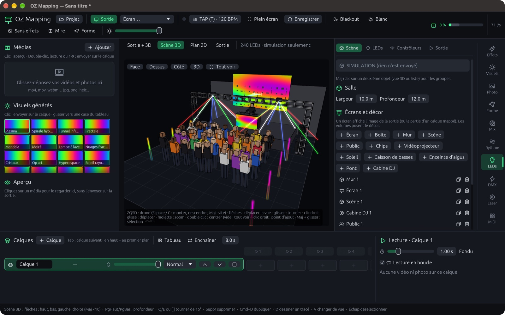
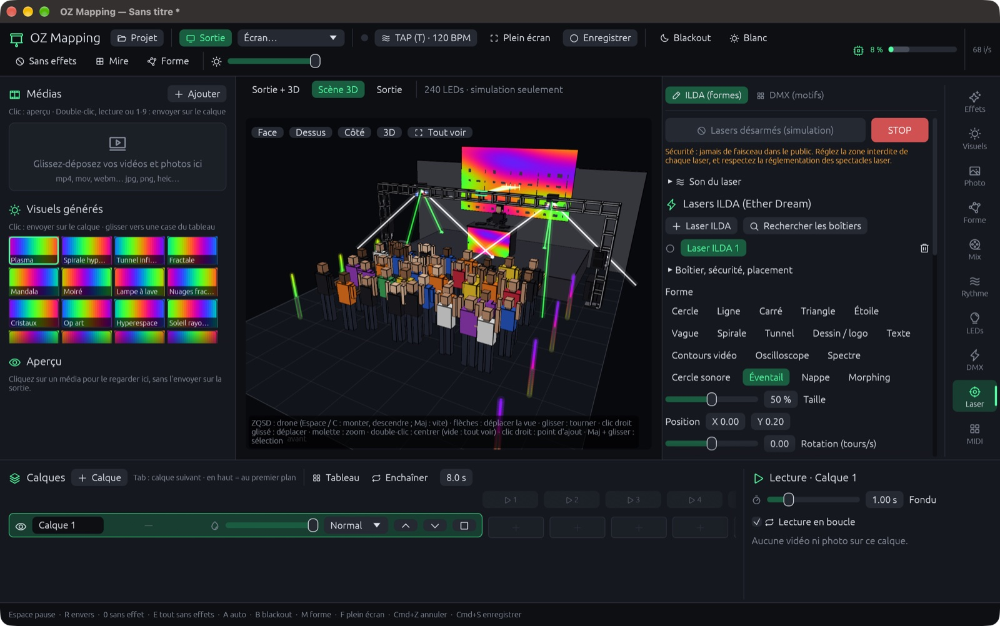
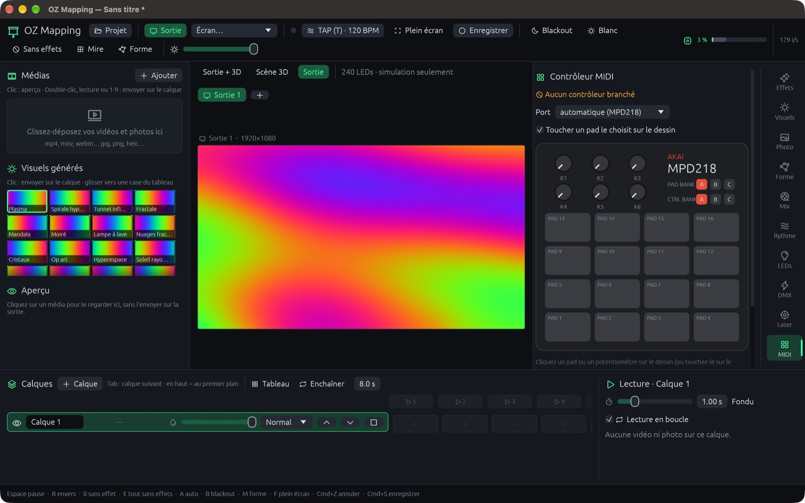

# OZ Mapping

Logiciel de vidéo-mapping live en Rust : calques vidéo superposés, formes de mapping complexes, effets et presets en temps réel, plusieurs sorties. Il pilote aussi le reste du spectacle : bandeaux LED (WLED), appareils DMX, lasers ILDA et contrôleur MIDI, le tout modélisé et simulé dans une scène 3D.





## Télécharger

Les versions compilées sont sur la page [Releases](https://github.com/azpery/ozmapping/releases/latest) :

- **Windows** : `OZ-Mapping-<version>-windows-x64.zip`. Dézippez puis lancez `OZ Mapping.exe` ; ffmpeg est inclus.
- **macOS** (Apple Silicon et Intel) : `OZ-Mapping-<version>.dmg`. Glissez l'app dans Applications. La première fois, faites clic droit sur l'app puis « Ouvrir » : elle n'est pas signée par un compte Apple Developer. ffmpeg doit être installé : `brew install ffmpeg`.

Le paquet Windows contient ffmpeg, sous licence GPL (fichier `ffmpeg/LICENSE.txt`). Il s'agit des builds [BtbN/FFmpeg-Builds](https://github.com/BtbN/FFmpeg-Builds), dont le code source est disponible sur [ffmpeg.org](https://ffmpeg.org/download.html) et sur ce dépôt.

## Compiler

Prérequis : Rust (stable), ffmpeg et ffprobe (`brew install ffmpeg` sur macOS, `apt install ffmpeg` sur Linux).

```sh
cargo run --release
cargo run --release -- clip1.mp4 clip2.mov   # ajoute les vidéos et lance la première
cargo run --release -- spectacle.ozmap       # ouvre un projet
```

**Application macOS** :

```sh
scripts/build-macos.sh              # Mac de cette architecture
scripts/build-macos.sh --universal  # Apple Silicon + Intel
```

Le script produit `dist/OZ Mapping.app` (avec son icône) et `dist/OZ-Mapping-<version>.dmg`. L'app reçoit une signature ad hoc, pas une signature Apple Developer : sur un autre Mac, faites la première fois clic droit sur l'app puis « Ouvrir ». ffmpeg doit être installé sur la machine.

**Windows** : le build se fait sur GitHub Actions (workflow « Build ») : onglet **Actions** > **Build** > **Run workflow**, ou en poussant un tag `v*`, qui publie aussi une release. Le zip contient `OZ Mapping.exe` et ffmpeg (dans `ffmpeg/bin`). Le même workflow produit le .dmg macOS universel.

## Sommaire

- [L'interface](#linterface)
- [Médias, calques et sorties](#médias-calques-et-sorties)
- [Tableau de presets](#tableau-de-presets)
- [Effets](#effets)
- [Visuels générés](#visuels-générés)
- [Mix auto](#mix-auto)
- [Forme : surface, déformation, masque](#forme--surface-déformation-masque)
- [Rythme](#rythme)
- [Scène 3D](#scène-3d)
- [LEDs WLED](#leds-wled)
- [DMX](#dmx)
- [Laser](#laser)
- [Contrôleur MIDI](#contrôleur-midi)
- [Plusieurs machines en réseau](#plusieurs-machines-en-réseau)
- [Enregistrer, projet, annuler, crash](#enregistrer-projet-annuler-crash)
- [Raccourcis clavier](#raccourcis-clavier)
- [Architecture](#architecture)

## L'interface

- **À gauche** : les médias, les visuels générés et un moniteur d'aperçu.
- **Au centre** : l'aperçu de la sortie, la scène 3D, ou les deux (boutons « Sortie + 3D », « Scène 3D », « Sortie » au-dessus ; « Sortie + 3D » d'office dès que la scène contient quelque chose). La scène 3D est visible depuis tous les onglets.
- **En bas** : les calques, le tableau de presets et le panneau Lecture.
- **À droite** : les réglages. Les onglets latéraux choisissent une famille (Effets, Visuels, Photo, Forme, Mix, Rythme, LEDs, DMX, Laser, MIDI), des onglets horizontaux en choisissent la section.
- **En haut** : projet, sortie et son écran, tap tempo, plein écran, enregistrement, blackout, écran blanc, sans effets, mire, édition de la forme, luminosité générale, jauge CPU.

Si l'effet choisi ne se voit pas (calque masqué, vide, à opacité 0 ou recouvert par un calque opaque), un bandeau propose de l'appliquer sur un calque visible.

## Médias, calques et sorties

**Médias.** Bouton « + Ajouter… » ou glisser-déposer : vidéos (mp4, mkv, mov, avi, webm…) et photos (JPG, PNG, HEIC, WebP, BMP, TIFF), chacune avec sa miniature. Une photo s'affiche comme une image fixe sur son calque, avec fondus, effets, masque, déformation et mix auto ; « Animer la photo… » (panneau Lecture) ouvre ses contours animés.
- **Clic** : aperçu dans le moniteur de gauche, sans toucher à la sortie.
- **Double-clic**, **GO**, touches **1-9** ou **← →** : envoie le média sur le calque sélectionné, avec un fondu enchaîné.
- **Lecture à l'envers** : bouton du panneau Lecture ou touche **R**. La vidéo est décodée par petits morceaux de la fin vers le début (en 1280×720 au maximum).

**Calques** (panneau du bas, jusqu'à 16). Chaque calque a sa vidéo ou son visuel, son opacité, son mode de fusion (Normal, Addition, Écran, Produit, Éclaircir, Assombrir), ses effets et sa forme. Le calque du haut de la liste est au premier plan. **Tab** passe au calque suivant.

**Sorties.** La fenêtre « Sortie » s'ouvre au démarrage. Choisissez l'écran du projecteur dans le menu **Écran** de la barre du haut : la sortie s'y place en plein écran, et ce choix est retenu. Sinon, déplacez la fenêtre à la main et appuyez sur **F** ou double-cliquez dessus.

On peut créer plusieurs sorties : onglets « Sortie 1 | Sortie 2 | + » au-dessus de l'aperçu ; « + » crée une sortie, avec sa fenêtre et un premier calque.
- Chaque calque choisit sa sortie (menu « S1 », « S2 »… sur sa ligne). Une sortie compose donc ses propres calques et masques, à ses propres proportions.
- Pour la sortie montrée : fenêtre ouverte ou non, écran, plein écran.
- Clic droit sur un onglet : renommer, supprimer (ses calques reviennent à la sortie 1). Choisir un calque montre sa sortie.
- Dans la scène 3D, chaque écran et chaque vidéoprojecteur choisit la sortie qu'il affiche, et les LEDs celle qu'elles suivent.
- L'enregistrement vidéo enregistre la sortie 1.

## Tableau de presets

À droite des calques, chaque calque a une ligne de cases. Une case garde un média avec tous les réglages du calque : effets, visuel généré, mode AUTO, cadrage, opacité, fusion, déformation, masque, réaction au rythme, mix auto, vitesse et sens de lecture.

- **Clic sur une case vide** : enregistre l'état actuel du calque.
- **Clic sur une case pleine** : la joue sur son calque (fondu vidéo et transition d'effets). En revenant sur une case, sa vidéo reprend là où on l'avait quittée. Ce qu'on règle pendant qu'une case joue est gardé dans la case.
- **Glisser un média** (ou un visuel généré) sur une case vide en fait un nouveau preset ; sur une case pleine, il remplace son média en gardant ses effets.
- **Clic droit** : renommer, remplacer par l'état actuel, vider.
- **▶ en haut d'une colonne** joue toutes ses cases d'un coup ; **Enchaîner** passe d'une colonne remplie à la suivante, en boucle, avec la durée choisie.

## Effets

Onglet Effets ; ils s'appliquent au calque sélectionné.

- **49 presets** intégrés : Néon, Kaléido, Mandala, Miroir 4, Tunnel, Rétro VHS, Glitch, 8-bit, Pop art, Arc-en-ciel, Psyché, Rêve, Noir & blanc, Duotone rose, Bleu glacé, Négatif, Strobe, Vortex, Tunnel acide, Liquide, Acide, Mosaïque, Écho, Solarisé, Respiration, Trip, Cube 3D, Sphère, Carte 3D, Cylindre, Relief, Anaglyphe, Drapeau, Thermique, Télé cathodique, Glitch numérique, Pellicule, Onde de choc, Fish-eye, Hexagones, Trame BD, Droste, Zoom radial, ASCII, Tore, Accordéon, Terrain 3D, Pixels 3D, Halo.
- **Couleur** : teinte, saturation, caméra thermique, flou, halo lumineux (bloom)…
- **Distorsions** : fish-eye, ondes de choc, mosaïque hexagonale, Droste (l'image se répète en spirale infinie qui zoome), flou de zoom…
- **Psychédélique** : tourbillon, tunnel, mosaïque miroir, distorsion liquide, palette acide, arc-en-ciel spatial, solarisation, pulsation, écho.
- **Rétro** : télé cathodique, glitch numérique, grain de pellicule, trame BD, caractères ASCII.
- **3D** : l'image posée sur un objet en perspective (plan, cube, sphère, cylindre, tore) ou construite à partir de l'image : **terrain** (la clarté devient un relief) et **pixels 3D** (une ville de colonnes). Inclinaison, rotation automatique, distance de la caméra et éclairage réglables. Aussi **relief**, **anaglyphe** rouge/cyan, **drapeau** qui ondule, **accordéon**.
- « Aléatoire » tire une combinaison au hasard ; « Mémoriser » crée vos propres presets (clic droit pour en supprimer un) ; la durée de « Transition » règle le passage d'un preset à l'autre.
- **Revenir sans effet** : « Aucun » (touche **0**) retire les effets du calque et coupe son mode AUTO. « Sans effets » (touche **E**) affiche toutes les vidéos brutes sans perdre les réglages ; un second appui les rétablit.
- **AUTO** (touche **A**) : enchaîne des effets tirés au hasard sur le calque sélectionné. Un **thème** oriente les choix (Tout, Psychédélique, Couleur, Vitesse, Géométrie, Glitch, Doux), l'**intensité** dose les effets générés ; on règle l'intervalle, la durée du fondu et la part d'**effets inédits** (inventés plutôt que repris d'un preset ; « Mémoriser » garde un effet inventé qui plaît). Le stroboscope est exclu par défaut. Chaque calque a son propre mode AUTO.

## Visuels générés

Onglet Visuels. 34 visuels calculés en direct, sans vidéo, avec 8 palettes, vitesse, taille, détail et rotation des couleurs. Ils remplacent la vidéo du calque ou s'y mélangent, et passent par les effets, le masque et la déformation. Un enchaînement automatique change de motif et de palette au hasard.

- **Motifs** : plasma, spirale hypnotique, tunnel infini, fractale, mandala, moiré, lampe à lave, nuages, cristaux, op art, hyperespace, soleil rayonnant, ruche, caustiques, aurore boréale, quasicristal, galaxie, labyrinthe, grille rétro, flammes, électricité, gouttes.
- **8 visuels 3D** par lancer de rayons : Mandelbulb, éponge de Menger, kaléidoscope 3D, anneaux 3D, cubes infinis, gyroïde, sphères infinies, colonnes torsadées.
- **Taches de peinture** : les gouttes tombent sur les temps et les basses (grosses taches) et sur les aigus (gouttelettes) ; les couleurs se mélangent comme de vrais pigments, la peinture brille, coule, sèche et s'efface.
- **Route cartoon** : un voyage en voiture psychédélique piloté en direct (virages, bosses, montagnes russes, météo, éclairs sur les temps, voiture, décor du bord de route).
- **Voyage temporel** : un vortex d'horloges affolées et de compteurs d'années.
- **Visage qui parle** (Visuels › Visage) : un visage humain en 3D à projeter sur une tête de mannequin ou une boule de cristal. Il parle (ou sa bouche suit le son), cligne des yeux, regarde autour de lui. Âge, genre, corpulence, teint, maquillage, expressivité, personnages tout prêts, cinq rendus (projection, naturel, spectre, statue, hologramme) ; **Mon visage (photo)** plaque une photo de face sur la tête. Modèle issu de MakeHuman (domaine public, `assets/face/LICENCE.txt`) ; `scripts/bake-face.py` le reconstruit.
- **Contours animés** : les contours de l'image s'illuminent et bougent (styles Néon doré, Dessin vivant, Arc-en-ciel, Vagues de lumière), idéal pour donner vie à une photo.
- **Sur la forme du masque** : animations qui épousent le contour du masque : néon, lueur, comètes, pointillés, lignes concentriques, échos, onde, respiration, avec des presets tout prêts.
- **Destruction** : la forme du masque se casse et laisse voir les calques du dessous (mur de briques, verre brisé, braises, poussière, tuiles). Avancement manuel, boucle automatique ou bouton « Casser ! ».

## Mix auto

Onglet Mix : cochez plusieurs vidéos (dans l'onglet ou avec l'icône de bobine sur chaque média), puis activez MIX AUTO. Le calque enchaîne des séquences de durée aléatoire : changement de vidéo ou saut à un autre moment, lecture à l'endroit ou à l'envers, vitesse variable, coupe franche ou fondu. Durées, probabilités, vitesses et fondus sont réglables ; chaque calque peut avoir son propre mix.

## Forme : surface, déformation, masque

Onglet Forme ; touche **M** pour éditer sur l'aperçu ou directement sur la sortie. **Maj** permet un réglage précis, la croix déplace toute la forme, **G** affiche une mire.

- **Cadrage** : Étirer, Ajuster (bandes transparentes) ou Remplir (bords rognés).
- **Surface** : **Grille** (de 1×1, 4 coins en perspective, à 8×8 points pour suivre une surface courbe), **Bézier** (4 coins et 2 poignées par bord pour courber les bords), **Triangle** (l'image se resserre vers le sommet) ou **Ellipse** (l'image entière dans un cercle ou une ellipse). Changer de forme garde la place de la surface ; « Aplatir » retire les courbures.
- **Masque** : polygone (rectangle, cercle, triangle, hexagone, étoile ou forme libre) avec adoucissement des bords et inversion. Double-clic sur un bord : ajouter un point ; clic droit sur un point : le supprimer.
- **Transformer tout le masque** : sur l'aperçu, un cadre pointillé entoure le masque : coins = agrandir ou réduire (Maj : librement, Alt : depuis le centre), milieux des côtés = plus large / plus étroit, plus haut / moins haut, poignée ronde = tourner (Maj : par 15°). Dans le panneau : largeur, hauteur, taille en %, miroirs.
- **Photo détourée** : avec un masque (détourage, SVG, forme), le cadre bleu épouse la découpe et non toute la photo ; ses poignées déplacent et redimensionnent la photo et sa découpe ensemble.
- **Masque SVG** : « Importer un SVG… » (ou glisser-déposer un `.svg`) reprend un logo comme masque : formes multiples, trous, courbes et traits. Les points restent éditables (2 000 au maximum). Les textes du SVG sont ignorés : convertissez-les en tracés.
- **Masque depuis une photo** : « Depuis une photo… » (ou glisser-déposer une image quand l'onglet Forme est ouvert) ouvre le détourage. Les photos HEIC (iPhone) sont lues par macOS ou par ffmpeg 7.1+.
  - **Sujet (IA)** : un petit réseau de neurones (U²-Net, intégré, sans connexion) trouve le sujet principal ; **Sensibilité** l'élargit ou le resserre.
  - **Cadrer l'objet** : glissez sur l'image pour encadrer ce que vous voulez ; Maj+glisser ajoute un cadre, « Toute l'image » les retire.
  - **Photo prise de côté** : « Caler sur l'image projetée visible sur la photo » repère le rectangle projeté (4 coins déplaçables) et corrige la perspective. « Projeter du blanc » éclaire le support pour la photo.
  - **Couleur du fond** : garde ce qui se distingue de la couleur des bords (logo sur fond uni). Un PNG transparent est pris tel quel.
  - Retouches : baguette magique (clic : ajouter, clic droit ou Alt+clic : retirer), annuler, inverser, boucher les trous, lisser.
  - **Mapper l'objet** affiche la photo détourée avec son masque calé dessus, puis passe en mode placement. L'onglet **Photo** propose ensuite une vingtaine d'animations en un clic (contours dorés, aura, néon, comètes, verre brisé, lave…). **Masque seul** garde uniquement le masque vectoriel.

## Rythme

Onglet Rythme : les effets réagissent au son ou à un tempo.

- **Source** : une entrée audio (micro, carte son) ou un tempo tapé (**TAP** dans la barre du haut ou touche **T** ; on peut aussi le saisir, le diviser, le doubler). Pour le son de l'ordinateur lui-même, passez par une entrée virtuelle (BlackHole sur Mac, « Mixage stéréo » sous Windows).
- **Bande** : les temps sont détectés dans les **basses** (par défaut), sur **tout** le son ou dans les **aigus**. Analyse toutes les 5 ms, avec un petit tampon pour limiter la latence.
- **Manuel** : chaque appui sur **T** (ou PULSE) donne une pulsation, sans tempo derrière.
- **Réactions toutes prêtes** : Pulsation, Club, Stroboscope, Glitch, Rotation, Miroir, Négatif, Onde de choc, Kaléido, Arc-en-ciel, Douceur.
- **Réaction du calque** : sur chaque temps (zoom, flash, secousse RVB, saut de teinte, négatif, stroboscope, glitch, onde de choc, kaléidoscope, rotation, miroir), et avec l'intensité de la bande (déformations, saturation).
- Le mode AUTO, le mix auto, les scénarios LED, le public de la scène 3D et les lasers peuvent suivre ce tempo.

## Scène 3D

La salle (largeur, profondeur) et son décor, posés en 3D un peu comme dans SketchUp (onglet LEDs › Scène) :

- **Écrans** et surfaces mappées qui affichent une sortie en direct (toute la sortie ou la zone d'un calque) ; volumes (boîte, mur).
- **Scène** (largeur, profondeur, hauteur du plateau) et **cabine DJ** posée dessus, avec ou sans DJ qui hoche la tête en rythme ; sa façade peut afficher l'image.
- **Public** qui danse : nombre de personnes, taille, énergie ; chacun bouge sur le tempo de l'onglet Rythme.
- **Vidéoprojecteur** : projette une sortie sur tout ce qui est devant lui, avec sa perspective (rapport de projection réglable, cône affiché ; pas encore d'ombres portées).
- **Caissons de basses** (la membrane bat sur les temps), **enceintes d'aigus** sur pied, **pont** en treillis (portée, hauteur, section) où accrocher lasers, derbys ou bandeaux.
- **Chips** : panneaux de bois ondulés superposés en V (nombre, recouvrement, écart entre couches, ondulation, dégradé de couleurs). « Poser les LEDs entre les panneaux » crée une bande cachée derrière le bord de chaque panneau, qui éclaire celui de derrière (G1, G2… et D1, D2… du centre vers les bords, une sortie par bande). Le **soleil** à rayons est un objet à part, à poser devant.
- « Caler l'image des LEDs sur cet écran » : les LEDs prolongent l'image de l'écran.

**Navigation**
- Glisser dans le vide : tourner la vue dans tous les sens ; clic droit glissé (ou molette enfoncée) : la déplacer ; molette : zoomer ; double-clic : centrer (dans le vide : tout voir). Boutons Face, Dessus, Côté, 3D, Tout voir.
- **Mode drone** (souris sur la vue) : ZQSD (WASD sur clavier anglais) pour avancer, reculer, se décaler ; Espace / C pour monter, descendre ; Maj pour aller vite ; en vol, glisser regarde autour de soi. Sans objet choisi, les flèches déplacent la vue en haut, en bas, à gauche, à droite.
- **Point d'ajout** : clic droit dans la scène pose un repère ; les objets ajoutés ensuite y apparaissent.

**Objets**
- Cliquer un objet ouvre sa fiche (cotes affichées dans la vue). Glisser le déplace au sol, Maj+glisser le monte ou le descend, Alt+glisser le tourne par pas de 15°.
- Clavier : flèches haut, bas, gauche, droite (Maj ×10), PgHaut/PgBas profondeur, Q/E ou [ ] tourner de 15°, Suppr supprimer, Cmd+D dupliquer, V changer de vue, Échap désélectionner.
- **Rectangle de sélection** : Maj + glisser dans le vide (Maj : ajouter à la sélection). Il prend bandeaux, décor, appareils DMX et lasers ; les objets choisis bougent, se groupent ou se suppriment ensemble.
- **Groupes d'objets** : Maj+clic sur un deuxième objet les groupe ; un clic sur un membre choisit tout le groupe, qui se déplace, se tourne, se redimensionne (en %) et se supprime d'un bloc. « Modifier un objet seul », « Dégrouper ». Les chips et leurs bandes forment un groupe automatiquement.
- Le survol d'une LED donne son élément, son adresse et sa couleur ; l'éclair d'un élément le fait clignoter pour le repérer.

## LEDs WLED

Onglet LEDs : bandeaux LED branchés sur des ESP32 avec [WLED](https://kno.wled.ge). Rien n'est envoyé tant que le gros bouton « Simulation » n'est pas passé sur **Envoi aux WLED** : on teste d'abord dans la scène 3D. Les couleurs partent en DDP (UDP, port 4048) ; quand l'envoi est coupé, WLED reprend ses propres effets au bout de quelques secondes.

**Poser les LEDs** (LEDs › LEDs)
- Colonnes, bandes, anneaux, matrices (zigzag ou non), spirales ; « Exemple : 8 colonnes » pose deux rangées de colonnes. Pour chaque élément : nombre de LEDs, dimensions, position, rotation, sens du câblage.
- **Tunnel d'arches** : nombre d'arches, écart, largeur, hauteur des murs et du sommet, voûte à pans ou arrondie, bandes au sol ; groupes de l'avant vers le fond pour que la lumière coure dans le tunnel.
- **Dessiner en 2D** : une planche à dessin en mètres (quadrillage, zoom, photo de référence à l'échelle pour décalquer un élément réel). Points tous les 5 cm, Maj : horizontale / verticale / 45°, clic sur le premier point : boucle fermée ; longueur et nombre de LEDs affichés. « Ajouter à la scène » la pose debout (ou « Au sol », « Au plafond ») ; « Modifier en 2D » la rouvre.
- **Dessiner en 3D** (touche D) : les points se posent un à un dans la vue, au sol ou sur la face d'un mur, d'un écran ou d'une boîte (Maj : à la hauteur du point précédent ; Entrée ou double-clic : terminer ; Retour arrière : retirer le dernier point ; Échap : annuler).
- Les LEDs se répartissent régulièrement sur les tracés (30, 60, 96 ou 144 LEDs/m), dont les points restent modifiables.

**Contrôleurs et câblage** (LEDs › Contrôleurs)
- Autant de WLED que nécessaire : adresse IP, modèle (ESP32 8 sorties, Gledopto…), pins des sorties, ordre des couleurs. Un contrôleur éteint ou lent ne retarde pas les autres.
- **Branchements** : un tableau de tous les bandeaux avec leur contrôleur, leur sortie (pin), leur nombre de LEDs et leur sens, modifiables sur place. Les LEDs se suivent sortie par sortie, comme dans WLED.
- « Lire » récupère la configuration du contrôleur ; « Envoyer la configuration… » écrit les sorties dans WLED, le redémarre et crée un segment par élément (après confirmation).
- **Ordre des LEDs** : « Voir le câblage » montre dans la vue 3D le début et le sens de chaque bandeau, son rang et sa première adresse (« S1·2  #30 »), et en pointillés le fil d'un bandeau au suivant. « Câbler à la souris » : on clique les bandeaux dans l'ordre du fil, près du bout où arrive le signal. Dans la liste, on glisse un bandeau par sa poignée ; Cmd+clic (Ctrl+clic sous Windows) et Maj+clic en choisissent plusieurs, qui glissent ensemble et reçoivent d'un coup un sens, une sortie, un groupe ou une suppression.

**Ce qu'affichent les LEDs** (LEDs › Sortie)
- **Image de la sortie** : chaque LED prend la couleur de l'image à sa place, vue de face, de dessus ou de côté, sur la sortie choisie (les cercles sur l'aperçu montrent où).
- **Couleur de la vidéo** : tout le bandeau prend la couleur dominante de la vidéo, lissée (éclairage d'ambiance).
- **Scénarios** : les bandeaux jouent ensemble, groupe après groupe, comme dans [organic_tears_drops](https://github.com/azpery/organic_tears_drops) : allumage l'un après l'autre, battement de cœur, vague, vague de couleurs, arc-en-ciel, comètes qui serpentent de bandeau en bandeau, étincelles, vumètre. Calés sur le tempo, vitesse réglable, enchaînement au hasard avec fondu.
- **Groupes de bandeaux** : ils fixent l'ordre des scénarios (automatique : du centre vers les bords, de gauche à droite, de l'avant vers le fond ; ou glisser-déposer). Chaque groupe peut avoir **son propre effet** (image d'une sortie, couleur de la vidéo, scénario, couleur unie, arc-en-ciel, éteint) et sa luminosité.
- **Réaction au son** : « Suit le volume » et « Flash sur les temps », sur les basses ou tout le son, par-dessus n'importe quel effet (un groupe qui a son effet peut ne pas y réagir).
- **Mires de test** : couleur unie, arc-en-ciel, chenillard (vérifie le sens), balayages gauche-droite, bas-haut, avant-fond (vérifient les positions), identification (chaque élément d'une couleur, sa première LED en blanc).
- Luminosité et images/s réglables ; le blackout éteint aussi les LEDs.

## DMX

Onglet DMX : lasers, derbys, machines à bulles et à fumée, projecteurs RGB ou appareils quelconques, posés dans la scène 3D comme les autres objets. Le simulateur montre leurs faisceaux, la fumée et les bulles.

- Chaque appareil a son univers, son adresse et ses canaux (profils de départ à adapter selon la notice : nom, rôle et valeur de chaque canal), un interrupteur, un bouton « Fumée ! » / « Bulles ! » / « Flash ! » à fond tant qu'on appuie, et « Sur les temps » (le laser change de motif, le projecteur flashe).
- **Envoi** (DMX › Sortie) : Art-Net, sACN (E1.31) ou interface USB Enttec DMX USB Pro, avec son propre interrupteur.

## Laser



Onglet Laser.

**Lasers ILDA** pilotés par un boîtier Ether Dream (réseau ; « Rechercher les boîtiers ») :
- **Formes** : cercle, ligne, carré, triangle, étoile, vague, spirale, tunnel, dessin à main levée, logo SVG.
- **Texte** : police à un trait, défilement, accents acceptés.
- **Contours vidéo** : le laser trace en direct les contours de l'image d'une sortie, avec un seuil de clarté.
- **Son** : oscilloscope, spectre en barres, cercle sonore.
- **Faisceaux** : éventail qui balaie, nappe « liquid sky » qui ondule (nombre, amplitude, vitesse).
- **Morphing** entre deux réglages mémorisés.
- Taille, position, rotation, couleur ou arc-en-ciel, pulsation sur les temps, ondulation ; « Réagit au son » fait suivre le volume à la taille.
- **Son du laser** : la même entrée audio que l'onglet Rythme ou une entrée à part (autre carte son, retour de console), avec sensibilité, vumètre, forme d'onde et spectre.

**Lasers DMX** (par exemple Laserworld par leur entrée DMX ; leur réseau ShowNET est réservé à leur logiciel) : galerie de 16 motifs nommables, taille, rotation, position, couleur, vitesse, strobo, motif sur les temps.

Dans la scène 3D, les faisceaux s'arrêtent sur le premier objet touché (mur, chips, écran, sol), où la forme se dessine.

**Sécurité** : lasers désarmés au lancement (jamais réarmés tout seuls, même après un crash), bouton STOP (Échap dans l'onglet), zone interdite sous laquelle rien n'est tracé, luminosité maximale par laser. Ne dirigez jamais un faisceau vers le public.

## Contrôleur MIDI



Onglet MIDI : l'Akai MPD218 est dessiné (6 potentiomètres, 16 pads, banques A, B, C) et se connecte tout seul dès qu'il est branché (ou choisir le port).

- On frappe un pad ou on tourne un potentiomètre : il se sélectionne sur le dessin, il ne reste qu'à choisir sa commande. Les pads frappés s'allument, les potentiomètres montrent leur position.
- **Pads** : case ou colonne du tableau, preset, effet au hasard, sans effet, média, média suivant / précédent, calque, blackout (bascule ou tant qu'on appuie), écran blanc, sans effets, mire, tap tempo, pause, lecture à l'envers, AUTO, « Casser ! », envoi aux WLED, scénario LED, appareil DMX (bascule ou tant qu'on appuie), laser (armer, STOP, réglage mémorisé).
- **Potentiomètres** : luminosité générale, opacité d'un calque, vitesse de lecture, durée des transitions, luminosité des LEDs, ou un réglage d'effet (teinte, zoom, kaléidoscope, tourbillon…).
- « Apprendre » associe un pad du dessin au message réellement reçu (preset modifié sur le contrôleur, ou autre contrôleur MIDI). Des remplissages tout prêts sont proposés. Les assignations sont gardées d'une session à l'autre.

## Plusieurs machines en réseau

Bouton **Réseau** de la barre du haut : plusieurs OZ Mapping du même réseau local travaillent ensemble. Une modification faite sur l'une se répercute sur les autres : calques, effets, masques, tableau, scène 3D, LEDs, lecture des vidéos (média lancé, pause, vitesse, sens, position), blackout, écran blanc, sans effets, mire.

- Cochez « Synchroniser sur le réseau local » sur chaque machine. Elles se trouvent seules (diffusion UDP, port 47821 ; liaisons TCP, port 47822) ; sinon, « Se lier » avec l'adresse IP de l'autre. Seules les machines de la même **salle** se synchronisent.
- Une machine qui arrive reprend le projet de celles qui sont déjà là.
- Tout le monde peut modifier : si deux machines changent la même chose au même moment, toutes gardent la même version.
- Une vidéo ou une photo absente d'une machine y est copiée automatiquement (dans le dossier de cache d'OZ Mapping, réutilisé ensuite). Seuls les médias du projet peuvent être demandés.
- Les automatismes (AUTO, mix auto, enchaînement du tableau, visuels qui changent seuls) tournent sur la machine arrivée la première, la **référence** ; les autres la suivent.
- Restent propres à chaque machine : l'écran de chaque sortie, le contrôleur MIDI, l'entrée audio, et les envois aux WLED, en DMX et aux lasers (à activer sur une seule machine).

## Enregistrer, projet, annuler, crash

**Enregistrer** (barre du haut) : enregistre la sortie 1 dans une vidéo MP4 (H.264), en 720p, 1080p ou 4K (aux proportions de la sortie), à 25, 30 ou 60 images/s, avec une durée maximale facultative. Le bouton devient « ● REC » avec le temps écoulé ; un clic l'arrête. La vidéo est rendue à part, indépendamment de la taille des fenêtres ; elle n'a pas de son.

**Projet** (menu Projet) : les fichiers `.ozmap` sont du JSON : médias, calques, effets, formes, presets, sorties, et toute l'installation (scène 3D, LEDs, DMX, lasers). Les médias rangés dans le dossier du projet sont enregistrés en chemins relatifs, ce qui permet de déplacer le dossier. Un « * » dans le titre signale des modifications non enregistrées.

**Annuler** : Cmd+Z (Ctrl+Z sous Windows) annule la dernière modification, Cmd+Maj+Z (ou Ctrl+Y) la rétablit ; aussi dans le menu Projet. Un geste compte pour une étape (glisser un curseur, déplacer un objet de la scène, une frappe continue) ; les changements automatiques (AUTO, transitions, MIDI) n'en créent pas. L'historique repart de zéro à l'ouverture d'un projet.

**Après un crash** : la session est enregistrée toutes les 5 s. Au redémarrage, tout revient : projet en cours même non enregistré, écrans de sortie, envoi aux WLED et en DMX s'ils étaient actifs. Les vidéos repartent du début et les lasers restent désarmés.

**Jauge CPU** (en haut à droite) : la charge de l'app et de ses décodeurs ffmpeg, en pourcentage de la machine ; la partie grise montre le reste de la machine.

## Raccourcis clavier

| Raccourci | Action |
|-----------|--------|
| Cmd+N / Cmd+O | Nouveau projet / ouvrir un projet |
| Cmd+S / Maj+Cmd+S | Enregistrer / enregistrer sous |
| Cmd+Z / Cmd+Maj+Z | Annuler / rétablir |
| Espace | Pause / lecture du calque sélectionné |
| 1-9, ← → | Lancer un média sur le calque sélectionné |
| Tab | Calque suivant |
| T | Tap tempo |
| R | Lecture à l'envers / à l'endroit |
| 0 | Retirer les effets du calque (et couper AUTO) |
| E | Tout afficher sans effets (réglages conservés) |
| A | Mode AUTO sur le calque sélectionné |
| B | Blackout progressif |
| W | Écran blanc (photo de l'image projetée, réglage du projecteur) |
| G | Mire de calibration |
| M | Édition de la forme |
| F / Échap | Plein écran de la sortie / quitter le plein écran |

Sous Windows, Ctrl remplace Cmd. Dans la scène 3D (souris sur la vue, onglet LEDs) :

| Raccourci | Action |
|-----------|--------|
| Z Q S D, Espace / C, Maj | Drone : avancer, se décaler, monter / descendre, aller vite |
| Flèches (Maj ×10) | Objet choisi : haut, bas, gauche, droite ; sinon : déplacer la vue |
| PgHaut / PgBas | Objet choisi : profondeur |
| Q / E ou [ ] | Tourner l'objet de 15° |
| Maj + glisser | Rectangle de sélection |
| Clic droit | Poser le point d'ajout |
| D | Dessiner un tracé de LEDs |
| V | Changer de vue |
| Cmd+D / Suppr | Dupliquer / supprimer |
| Échap | Désélectionner |

## Architecture

**Image et vidéo**
- `src/video.rs` : décodage via un processus `ffmpeg` (images RGBA cadencées par un thread : vitesse, pause, seek, boucle, lecture à l'envers) ; photos ; miniatures.
- `src/renderer.rs` : composition OpenGL des calques et des sorties (fusion, fondus, maillage déformé, masque dans le shader, effets), captures hors écran pour les LEDs et la scène 3D.
- `src/effects.rs` : paramètres d'effets, interpolation, presets intégrés et aléatoires.
- `src/generator.rs`, `src/paint.rs`, `src/road.rs`, `src/face.rs`, `src/face_mesh.rs` : visuels générés (motifs, taches de peinture, route cartoon, visage qui parle).
- `src/surface.rs` : surfaces (grille Catmull-Rom, Bézier, triangle, ellipse), masques et leurs transformations, poignées d'édition.
- `src/cutout.rs` : détourage des photos (U²-Net via tract, modèle de couleurs, baguette magique).
- `src/mask.rs` : import SVG, contours d'une image détourée, rastérisation (tiny-skia).
- `src/recorder.rs` : enregistrement MP4 via ffmpeg.

**Spectacle**
- `src/leds.rs` : installation LED et scène 3D (contrôleurs, éléments, décor, groupes), couleurs (sortie, scénarios, son), envoi DDP et API JSON de WLED.
- `src/dmx.rs` : appareils DMX, profils, univers, Art-Net, sACN, Enttec DMX USB Pro.
- `src/laser.rs` : formes et images ILDA (texte, contours, audio, faisceaux, morphing), protocole Ether Dream.
- `src/midi.rs` : MPD218, assignations, apprentissage (midir).
- `src/net.rs` : plusieurs machines en réseau (découverte UDP, liaisons TCP, morceaux du projet versionnés, copie des médias).
- `src/rhythm.rs` : écoute audio (cpal), détection des temps, tap tempo, réactions des calques.
- `src/automix.rs` : tirage des séquences du mix auto.

**Application**
- `src/app/` : interface egui, découpée par domaine. `mod.rs` (état, boucle), `panels.rs`, `layers.rs`, `grid.rs` (tableau), `playback.rs`, `output.rs` (sorties), `effects_ui.rs`, `visuals_ui.rs`, `shape_ui.rs`, `cutout_ui.rs`, `rhythm_ui.rs`, `leds_ui.rs` (scène 3D, LEDs, DMX), `laser_ui.rs`, `midi_ui.rs`, `net_ui.rs` (synchro réseau), `undo.rs`, `recording.rs`, `project_io.rs`, `shortcuts.rs`.
- `src/project.rs` : fichier projet `.ozmap`.
- `src/screens.rs`, `src/thumbs.rs`, `src/cpu.rs` : écrans, miniatures en arrière-plan, mesure CPU.
- `src/theme.rs`, `src/icons.rs` : apparence et icônes [Phosphor](https://phosphoricons.com) (police dans `assets/`, licence MIT).
- `assets/models/u2netp.onnx` : modèle [U²-Net](https://github.com/xuebinqin/U-2-Net) (licence Apache 2.0, `assets/models/LICENSE-U2Net.txt`).

**Limites** : pas de son en sortie ; vidéos décodées en 1920×1080 au maximum ; la scène 3D est une simulation sans ombres portées. Les envois WLED, DMX et Ether Dream n'ont pas encore été essayés sur du matériel réel.
